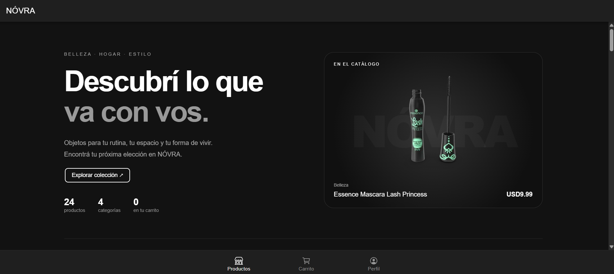
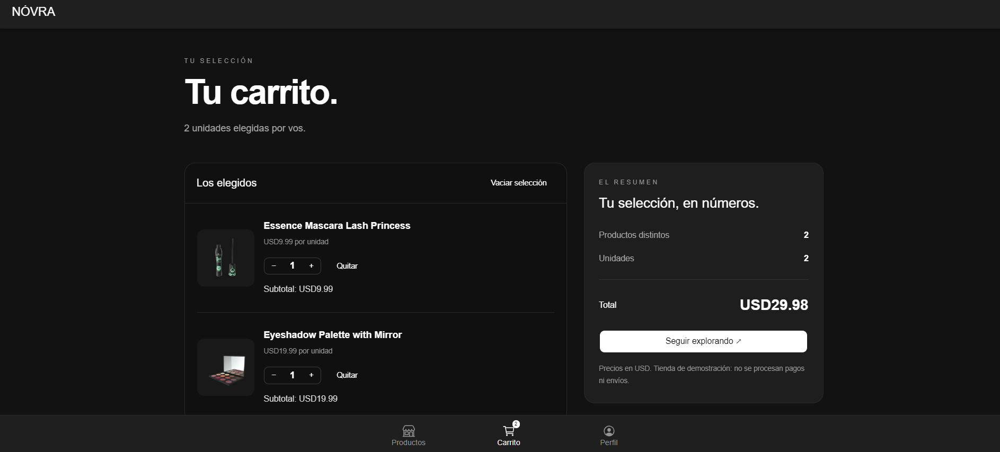
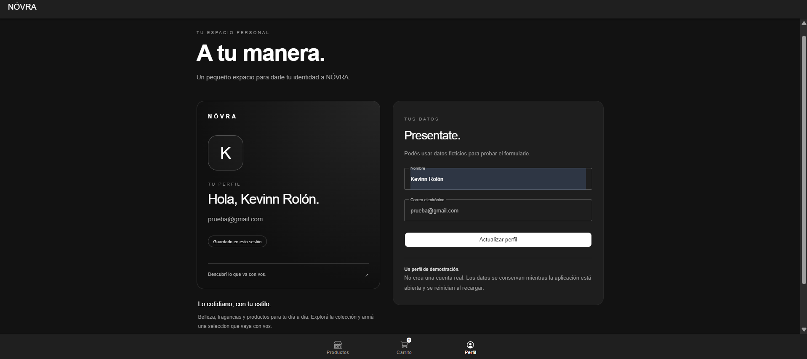

# NÓVRA

**Descubrí lo que va con vos.**

Tienda de demostración desarrollada con Ionic y Angular como proyecto final. Permite explorar productos, filtrar el catálogo, armar un carrito y completar un perfil de prueba.

## Integrante

- Kevinn Rolón

## Tecnologías

- Ionic 9.
- Angular 22 con componentes standalone.
- TypeScript, HTML y SCSS.
- Angular Signals para el estado de la interfaz y del carrito.
- HttpClient y RxJS para leer los datos.
- Ionicons para los íconos.


### Productos

- Catálogo con 24 productos y cuatro categorías.
- Portada con un producto destacado.
- Búsqueda por nombre o categoría.
- Filtros por categoría.
- Orden por precio ascendente o descendente.
- Indicador de carga, mensaje de error y botón para reintentar.
- Botones para agregar productos al carrito.

### Carrito

- Agregar, sumar, restar y quitar productos.
- Control de cantidades según la disponibilidad del catálogo.
- Cálculo de subtotales, unidades y total.
- Contador de unidades en la pestaña.
- Confirmación antes de vaciar la selección.
- Resumen lateral en escritorio y distribución vertical en celular.

### Perfil

- Formulario de nombre y correo electrónico.
- Validación de campos obligatorios y formato del correo.
- Tarjeta de identidad con nombre, inicial y correo.
- Actualización del perfil y aviso de guardado.

## Fuente de datos

Los productos provienen de [DummyJSON](https://dummyjson.com/docs/products).

Se descargaron y se guardaron en:

`src/assets/data/productos.json`

Durante su ejecución, la aplicación lee ese archivo local mediante `ProductosService`. La ruta está configurada en los dos archivos de environments.

Las imágenes conservan sus enlaces externos y necesitan conexión a internet. Los precios se muestran en USD y las cantidades disponibles son datos ficticios de la fuente.

## Cómo ejecutar

Requisitos:

- Node.js 24.x, a partir de la versión 24.15.0.
- npm.
- Git para clonar el repositorio.

Clonar e ingresar al proyecto:

```bash
git clone https://github.com/KevinnRolon/tienda-ionic.git
cd tienda-ionic
```

Instalar las dependencias:

```bash
npm ci
```

Iniciar el servidor de desarrollo:

```bash
npm start
```

Abrir la dirección que indique la terminal, normalmente `http://localhost:4200`.

Para detener el servidor, presionar `Ctrl + C`.

## Compilar

```bash
npm run build
```

La compilación se genera en la carpeta `www`.

## Organización del proyecto

- `src/app/models/`: interfaces de los datos.
- `src/app/services/`: lectura de productos y estado compartido del carrito.
- `src/app/tab1/`: catálogo de productos.
- `src/app/tab2/`: carrito.
- `src/app/tab3/`: perfil.
- `src/app/tabs/`: navegación entre pestañas.
- `src/assets/data/`: archivo JSON local.
- `src/environments/`: configuración de desarrollo y producción.

## Componentes de Ionic

Entre los componentes utilizados están:

`ion-searchbar`, `ion-grid`, `ion-card`, `ion-chip`, `ion-badge`, `ion-button`, `ion-spinner`, `ion-list`, `ion-item`, `ion-thumbnail`, `ion-alert`, `ion-input` e `ion-toast`.

Las listas y condiciones utilizan la sintaxis actual de Angular: `@for` y `@if`.

## Capturas de pantalla

### Productos



### Carrito



### Perfil



## Alcance de la demostración

La aplicación no realiza cobros, envíos ni autenticación real.

El carrito y el perfil se conservan al cambiar de pestaña mientras la aplicación está abierta. Se reinician al recargar la página.

## Uso de inteligencia artificial

Durante el desarrollo se utilizó Codex de OpenAI. El detalle de la asistencia, las solicitudes principales y las correcciones se documenta en `IA.md`.

## PDF de evidencias de uso

[Ver las capturas de Productos, Carrito y Perfil en un escenario de uso](docs/entrega/NOVRA-evidencias-de-uso.pdf).
